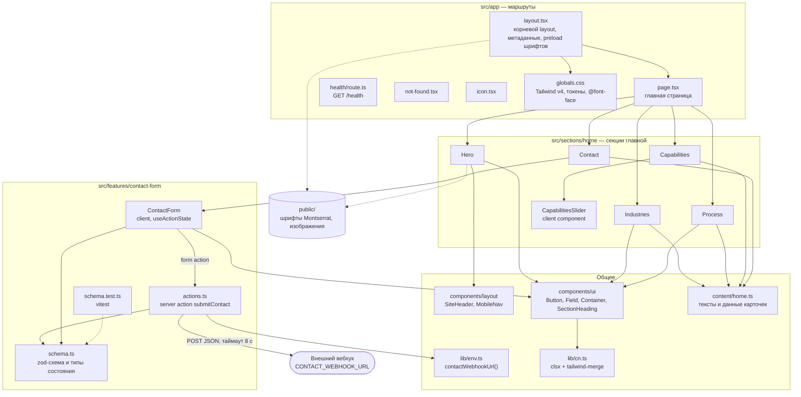
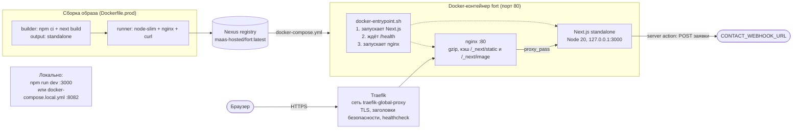

# Форт-9

Сайт Форт-9 на Next.js. Сейчас открыта только главная страница, свёрстанная по макету.

## Локально

```bash
npm install
npm run dev
```

Открыть http://localhost:3000. Проверка живости: http://localhost:3000/health.

```bash
npm run lint
npm run typecheck
npm test
npm run build
```

Docker на локальной машине (порт 8082):

```bash
docker network create maas-shared
docker compose -f docker-compose.local.yml up --build
```

`docker-compose.yml` только для серверов с Traefik (`traefik-global-proxy`). Перед первым деплоем замените `PUBLIC_HOST` (сейчас плейсхолдер `fort.example.com`) и путь образа, если реестр называется иначе.

## Шрифты

Файлы лежат в проекте, внешних CDN нет.

- `public/fonts/montserrat-cyrillic.woff2` и `montserrat-latin.woff2` — Montserrat (SIL OFL, лицензия в `public/fonts/OFL.txt`). Сейчас это основной шрифт страницы и шрифт таблиц характеристик.
- Заголовки и наборный текст в макете — TT Norms Pro (Regular 400, Medium 500, Bold 700). Положите woff2 в `public/fonts/tt-norms-pro/` и в `src/app/globals.css` объявите `@font-face` с семейством `"TT Norms Pro"`, затем замените `--font-sans` на это семейство. `--font-table` оставьте Montserrat: в макете таблицы набраны им.

## Заявки

Форма на главной проверяется схемой на сервере. Если задан `CONTACT_WEBHOOK_URL` (см. `.env.example`), заявка уходит туда POST-запросом с JSON. Без переменной сервер принимает заявку и пишет в лог, что она получена, без текста полей.

## Структура

- `src/app` — маршруты, корневой layout, `/health`
- `src/sections/home` — секции главной
- `src/features/contact-form` — форма, server action, схема
- `src/content/home.ts` — тексты и данные карточек
- `src/components` — шапка и UI-примитивы

## Архитектура

### Приложение

БД нет: тексты лежат в `src/content/home.ts`, статика в `public/`. Единственная серверная логика — server action формы заявки.



Если `CONTACT_WEBHOOK_URL` не задан, `submitContact` только пишет в лог, что заявка получена.

### Рантайм и деплой


